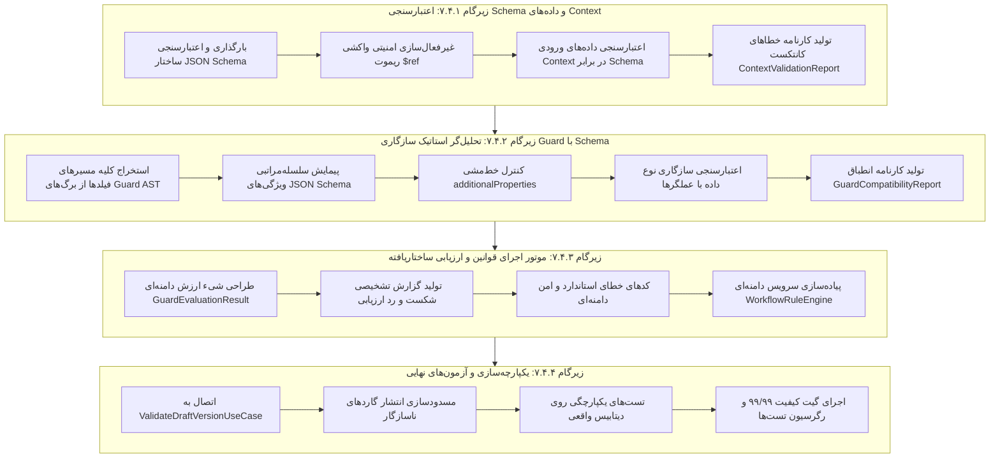

# سند تفکیک، طراحی و نقشه راه گام ۷.۴: موتور ارزیابی گارد و قوانین (Guard & Rule Engine)
> **تاریخ تنظیم سند:** ۲۷ آبان ۱۴۰۵ (18 نوامبر 2026)  
> **پروژه:** سامانه احراز هویت ویدئویی (Video Identity Verification)  
> **سرویس هدف:** سرویس مستقل گردش کار (`workflow` - پورت 8082)  
> **موقعیت در نقشه راه:** فاز هفتم — گام ۷.۴ (پس از تکمیل موفق گام‌های ۷.۱، ۷.۲ و ۷.۳)  
> **معماری:** Domain-Driven Design (DDD) خالص، ساختار بدون عوارض جانبی (Pure Functions & AST)  

---

## ۱. مقدمه و اهداف بنیادین گام ۷.۴ (Executive Summary)

در مدل معماری گردش کار پروژه، **گاردها (Guards)** شروط و قواعد منطقی مقید به یال‌های انتقال (`WorkflowTransition`) هستند. این شروط تعیین می‌کنند که آیا یک انتقال در زمان وقوع یک رویداد تجاری مجاز به انجام است یا خیر. داده‌های ورودی ارزیابی، تحت عنوان **کانتکست (Context)** توسط سرویس‌های بیرونی (مانند سرویس احراز هویت `auth`) در زمان اجرا تامین می‌شوند.

اگرچه در گام ۷.۱ ساختار پایه‌ای درخت نحو انتزاعی (Guard AST) و ارزیاب بولین ساده پیاده‌سازی گردید، اما برای رسیدن به استاندارد تجاری قطعی، مقاوم در برابر خطا و ایمن در سطح سازمانی (Enterprise-grade)، **گام ۷.۴** وظایف تکمیلی زیر را بر عهده دارد:

1. **اعتبارسنجی مستقل و امن شِما (Context Schema Validation):** پشتیبانی از استاندارد JSON Schema Draft 2020-12 با غیرفعال‌سازی مطلق واکشی شبکه‌ای `$ref`های بیرونی جهت حذف هرگونه آسیب‌پذیری جعل درخواست سمت سرور (SSRF).
2. **تحلیل‌گر استاتیک سازگاری گارد و شِما (Static Compatibility Analysis):** بررسی انطباق گارد با شِما پیش از انتشار، جهت جلوگیری از ارجاع به فیلدهای ناموجود در شِما یا استفاده از عملگرهای نامتناسب با نوع فیلد (مانند اعمال `GT` روی فیلد `string`).
3. **موتور اجرای قوانین با خروجی ساختاریافته (Structured Rule Engine):** ارتقای نتیجه ارزیابی از `boolean` ساده به شیء تشخیصی غنی (`GuardEvaluationResult`) که علاوه بر پاسخ انطباق، مسیر ارزیابی، علت رد شدن و کد خطای استاندارد را برای مانیتورینگ ادمین و کلاینت فراهم می‌کند.
4. **یکپارچه‌سازی با فرآیند انتشار (Validation Pipeline Integration):** پیوند زدن این اعتبارسنجی‌ها به گیت اعتبارسنجی پیش‌نویس (`ValidateDraftVersionUseCase`) به نحوی که هیچ نسخه گردش کاری که دارای گارد ناسازگار باشد امکان ورود به وضعیت `PUBLISH_PENDING` را پیدا نکند.

---

## ۲. دیاگرام ساختار و توالی زیرگام‌ها

---

## ۳. شرح تفصیلی زیرگام‌ها و اقلام تحویلی

### ۳.۱. زیرگام ۷.۴.۱: اعتبارسنجی امن Schema و داده‌های Context (Schema & Context Validation)
- **شرح مسئله:** هر نسخه گردش کار دارای یک Context Schema با فرمت JSON Schema Draft 2020-12 است. باید مطمئن شویم این شِما معتبر است و داده‌های ورودی ارسال‌شده توسط مصرف‌کننده در زمان اجرا با آن مطابقت دارد.
- **اقدامات و کلاس‌های طراحی‌شده:**
  - `ContextSchemaValidator`:
    - بررسی ساختار JSON Schema بدون رجوع به شبکه اینترنت (`network disabled`).
    - کنترل اندازه بیشینه سند شِما و عمق مجاز جهت جلوگیری از حملات محروم‌سازی سرویس (DoS).
  - `ContextValidationReport` و `ContextValidationError`:
    - کپسوله‌سازی نتیجه اعتبارسنجی داده‌های کانتکست با ارائه لیست مسیرهای نقض‌شده و نوع خطا.
  - افزودن قابلیت اعتبارسنجی در دامنه: `ContextSchema.validate(JsonNode contextData)`.
- **آزمون‌های واحد:**
  - شِماهای معتبر و استاندارد Draft 2020-12.
  - رد شِماهای نامعتبر، شِماهای دارای `$ref` به اینترنت یا روت‌های غیرآبجکت.
  - تست‌های اعتبارسنجی کانتکست با فیلدهای دارای مقدار معتبر، ناقص، یا تایپ متناقض.

---

### ۳.۲. زیرگام ۷.۴.۲: تحلیل‌گر استاتیک سازگاری گارد با شِما (Static Guard vs Schema Compatibility Analyzer)
- **شرح مسئله:** در زمان ایجاد یا ویرایش انتقال، ممکن است ادمین یک گارد مانند `verification.riskScore > 50` تعریف کند، اما فیلد `riskScore` در شِما وجود نداشته باشد یا از نوع `boolean` تعریف شده باشد. این عدم سازگاری باید به صورت استاتیک در مرحله اعتبارسنجی پیش‌نویس کشف شود، نه در زمان اجرای بیزینس.
- **اقدامات و کلاس‌های طراحی‌شده:**
  - `GuardSchemaCompatibilityAnalyzer`:
    - استخراج بازگشتی مسیرها (`path`) از گره‌های `ComparisonGuardNode`.
    - پیمایش مسیرها در گره `properties` شِما به ازای هر سطح از ساختار آبجکت.
    - بررسی سیاست `additionalProperties: false`. اگر فیلدی در شِما تعریف نشده باشد و شِما فیلدهای اضافه را غیرمجاز اعلام کرده باشد، گارد رد می‌شود.
    - ماتریس سازگاری عملگرها (Operator-Type Matrix):
      | عملگرهای Guard | نوع مجاز در JSON Schema |
      | :--- | :--- |
      | `GT`, `GTE`, `LT`, `LTE` | `number`, `integer` |
      | `EQ`, `NE` (مقایسه بولین) | `boolean` |
      | `EQ`, `NE` (مقایسه متنی/عددی) | `string`, `number`, `integer` |
      | `IN`, `NOT_IN` | نوع المان‌های آرایه باید با نوع فیلد بخواند |
      | `EXISTS`, `NOT_EXISTS` | مجاز برای کلیه انواع ساختار |
  - `GuardCompatibilityReport`: شامل وضعیت سازگاری (`compatible: boolean`) و لیست هشدارهای ساختاری یا خطاهای قطعی.
- **آزمون‌های واحد:**
  - آزمون تطابق کامل مسیرهای تودرتو (Nested Paths).
  - آزمون رد عملگر عددی روی فیلد متنی یا بولین.
  - آزمون رد فیلدهای اعلان‌نشده وقتی `additionalProperties: false` است.

---

### ۳.۳. زیرگام ۷.۴.۳: خروجی ساختاریافته و موتور اجرای قوانین (Structured Rule Engine)
- **شرح مسئله:** در حال حاضر تابع `GuardEvaluator.evaluate` خروجی دودویی `boolean` برمی‌گرداند. در محیط عملیاتی و پنل ادمین، کلاینت نیازمند دانستن دلیل دقیق عدم عبور از یک گارد است (مثلاً کدام گره در شرط `ALL` شکست خورد یا آیا خطای عدم تطابق شِما رخ داده است).
- **اقدامات و کلاس‌های طراحی‌شده:**
  - شیء ارزش `GuardEvaluationResult`:
    - `boolean matched`: آیا شرط برقرار شد؟
    - `String reason`: توضیح علت و نام گره‌ای که مانع انتقال شد.
    - `GuardEvaluationError error`: کد خطای تشخیصی امن (مانند `NONE`, `PATH_NOT_FOUND`, `TYPE_MISMATCH`, `SCHEMA_VIOLATION`, `EVALUATION_ERROR`).
    - `List<String> evaluatedPaths`: مسیرهایی که در تصمیم‌گیری مشارکت داشتند.
  - `WorkflowRuleEngine`:
    - رابط ورودی تمیز برای ارزیابی قوانین.
    - ارزیابی قطعی (Deterministic) و فاقد اثر جانبی (Side-effect free).
    - مصونیت کامل در برابر تزریق کد یا SpEL (طراحی فاقد مفسرهای کد پویا).
- **آزمون‌های واحد:**
  - ارزیابی ساختاریافته گره‌های منطقی عمیق و ترکیبی (`ALL`, `ANY`, `NOT`).
  - گزارش دقیق علت رد در ارزیابی‌های ترکیبی.

---

### ۳.۴. زیرگام ۷.۴.۴: یکپارچه‌سازی و آزمون‌های رگرسیون (Validation Integration & Verification)
- **شرح مسئله:** تحلیل‌گر استاتیک گارد باید به صورت رسمی در پایپ‌لاین اعتبارسنجی پیش‌نویس قرار گیرد تا پیش از درخواست انتشار، تمام انتقال‌ها اعتبارسنجی شوند.
- **اقدامات:**
  - تزریق `GuardSchemaCompatibilityAnalyzer` به [`WorkflowPublicationRequestService`](file:///d:/Amin/My%20Java%20Projects/video-identity-verification/workflow/src/main/java/com/example/videokyc/workflow/application/service/WorkflowPublicationRequestService.java).
  - افزودن خطاهای عدم تطابق گارد با شِما به کارنامه `ValidationReport` در متد `validateDraft(...)`.
  - ممانعت خودکار متد `requestPublication(...)` از ورود به وضعیت `PUBLISH_PENDING` در صورت ناسازگاری گاردها.
  - اجرای آزمون‌های یکپارچگی روی پایگاه داده واقعی.
  - اجرای گیت‌های کیفیت کلی شامل `verify_workspace.py` و `./mvnw test`.

---

## ۴. استانداردهای کیفی و معیارهای پذیرش (Quality Gates)

| معیار پذیرش | نحوه ارزیابی | وضعیت مورد انتظار |
| :--- | :--- | :---: |
| خلوص معماری دامنه (DDD) | بازرسی کد و اسکریپت `verify_workspace.py` | ۰ انوتیشن فریم‌ورکی در دامنه |
| امنیت شِما و SSRF | عدم استفاده از واکشی شبکه در شِما | مسدودسازی کامل شبکه در بارگذاری شِما |
| امنیت گارد و اسکریپت | عدم استفاده از SpEL / JavaScript / SQL | فقط عملگرهای محدود و امن AST |
| موفقیت آزمون‌های خودکار | اجرای `./mvnw test` با Java 25 | **۱۰۰٪ PASS (0 Failures)** |
| سلامت ساختاری فضای کار | اجرای `python scripts/verify_workspace.py` | **PASS (99/99)** |
