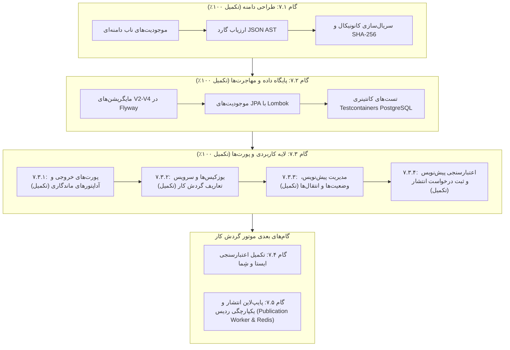

# گزارش پیشرفت گام هفتم: موتور جنریک گردش کار (Generic Workflow Engine)
> **تاریخ تنظیم گزارش:** ۲۷ آبان ۱۴۰۵ (18 نوامبر 2026)  
> **پروژه:** سامانه احراز هویت ویدئویی (Video Identity Verification)  
> **سرویس هدف:** سرویس مستقل گردش کار (`workflow` - پورت 8082)  
> **معماری:** Domain-Driven Design (DDD) به همراه معماری پورت‌ها و آداپتورها (Hexagonal Architecture)  

---

## ۱. نمای کلی و اهداف فاز هفتم (Executive Summary)

فاز هفتم با هدف پیاده‌سازی **موتور جنریک و توزیع‌شده گردش کار** به عنوان یک میکروسرویس کاملاً مستقل طراحی شده است. این سرویس وظیفه دارد:
1. تعاریف گردش کار، نسخه‌بندی پیش‌نویس/منتشرشده، وضعیت‌ها و انتقال‌ها را به صورت مستقل از سناریوهای تجاری مدیریت کند.
2. موتور اعتبارسنجی و قوانین فاقد عوارض جانبی (Side-effect free Guard DSL) را با استفاده از AST تو در تو (Nested AST) اجرا کند.
3. با استفاده از اسنپ‌شات‌های کانونیکال (Canonical JSON) و چک‌سام SHA-256، تعاریف تغییرناپذیر (Immutable Published Versions) را تولید و جهت مصرف با کارایی بالا در ردیس (Redis) ذخیره کند.
4. رویدادهای تغییر و فعال‌سازی نسخه‌ها را از طریق معماری رویدادمحور (EDA) و RabbitMQ منتشر کند.

> **قانون قطعی معماری:** سرویس `workflow` مالک وضعیت نمونه‌های تجاری کاربران یا تاریخچه تلاش‌های احراز هویت نیست؛ این داده‌ها به صورت مجزا در دیتابیس `auth` نگهداری می‌شوند. همچنین لایه دامنه‌ای `workflow` فاقد هرگونه وابستگی به Spring، JPA یا ابزارهای بیرونی است (Pure Domain).

---

## ۲. خلاصه وضعیت پیشرفت به تفکیک مراحل گام ۷

---

## ۳. جزئیات اقدامات انجام‌شده

### ۳.۱. گام ۷.۱: طراحی دامنه، موجودیت‌ها و ارزیاب گارد (تکمیل ۱۰۰٪)
- **موجودیت‌ها و ریشه‌های تجمیعی دامنه‌ای:**
  - [`WorkflowDefinition`](file:///d:/Amin/My%20Java%20Projects/video-identity-verification/workflow/src/main/java/com/example/videokyc/workflow/domain/definition/WorkflowDefinition.java): مدیریت شناسه کسب‌وکاری یکتای `workflow_key` و وضعیت‌های چرخه حیات (`ACTIVE`, `INACTIVE`, `ARCHIVED`).
  - [`WorkflowVersion`](file:///d:/Amin/My%20Java%20Projects/video-identity-verification/workflow/src/main/java/com/example/videokyc/workflow/domain/version/WorkflowVersion.java): مدیریت گراف وضعیت‌ها و انتقال‌ها، فقط در وضعیت `DRAFT` قابل ویرایش و پس از انتشار به صورت تغییرناپذیر (`PUBLISHED`).
  - [`WorkflowState`](file:///d:/Amin/My%20Java%20Projects/video-identity-verification/workflow/src/main/java/com/example/videokyc/workflow/domain/state/WorkflowState.java): گره‌های وضعیت با نقش‌های ساختاری (`INITIAL`, `INTERMEDIATE`, `FINAL`).
  - [`WorkflowTransition`](file:///d:/Amin/My%20Java%20Projects/video-identity-verification/workflow/src/main/java/com/example/videokyc/workflow/domain/transition/WorkflowTransition.java): یال‌های جهت‌دار میان وضعیت‌ها با پشتیبانی از Guard Expression.
  - [`PublicationJob`](file:///d:/Amin/My%20Java%20Projects/video-identity-verification/workflow/src/main/java/com/example/videokyc/workflow/domain/publication/PublicationJob.java): ردیابی چرخه حیات انتشار غیرهمزمان، قفل واگذاری به Worker و مدیریت بازیابی بعد از خطا.
- **شیءهای ارزش (Value Objects):**
  - [`WorkflowKey`](file:///d:/Amin/My%20Java%20Projects/video-identity-verification/workflow/src/main/java/com/example/videokyc/workflow/domain/definition/WorkflowKey.java)، [`VersionNumber`](file:///d:/Amin/My%20Java%20Projects/video-identity-verification/workflow/src/main/java/com/example/videokyc/workflow/domain/version/VersionNumber.java)، [`StateKey`](file:///d:/Amin/My%20Java%20Projects/video-identity-verification/workflow/src/main/java/com/example/videokyc/workflow/domain/state/StateKey.java)، [`TransitionKey`](file:///d:/Amin/My%20Java%20Projects/video-identity-verification/workflow/src/main/java/com/example/videokyc/workflow/domain/transition/TransitionKey.java).
  - [`ContextSchema`](file:///d:/Amin/My%20Java%20Projects/video-identity-verification/workflow/src/main/java/com/example/videokyc/workflow/domain/version/ContextSchema.java): مبتنی بر استاندارد JSON Schema Draft 2020-12.
  - [`SnapshotChecksum`](file:///d:/Amin/My%20Java%20Projects/video-identity-verification/workflow/src/main/java/com/example/videokyc/workflow/domain/version/SnapshotChecksum.java): محاسبه هش امنیتی ۶۴ کاراکتری SHA-256.
- **موتور ارزیاب گارد (Guard DSL AST Parser & Evaluator):**
  - عملگرهای ترکیبی: `ALL`, `ANY`, `NOT`.
  - عملگرهای مقایسه‌ای: `EQ`, `NE`, `GT`, `GTE`, `LT`, `LTE`, `IN`, `NOT_IN`, `EXISTS`, `NOT_EXISTS`.
  - اعمال سقف عمق درخت (Depth 8) و تعداد کل گره‌ها (100 Nodes) جهت ممانعت از حملات ReDoS یا Stack Overflow.
  - اعتبارسنجی مستقل و ایزوله در [`GuardDslTest`](file:///d:/Amin/My%20Java%20Projects/video-identity-verification/workflow/src/test/java/com/example/videokyc/workflow/domain/GuardDslTest.java).

---

### ۳.۲. گام ۷.۲: طراحی پایگاه داده و مهاجرت‌ها (تکمیل ۱۰۰٪)
- **مایگریشن‌های Flyway (سازگار با PostgreSQL و H2):**
  - `V2`: جداول تعاریف، نسخه‌ها، وضعیت‌ها، انتقال‌ها، ایندکس‌های یکتا و قیود جامعیت.
  - `V3`: جدول وظایف انتشار (`workflow_publication_jobs`) و ایندکس‌های بهینه‌سازی شده Worker.
  - `V4`: جدول رویدادهای برون‌فرست (`workflow_outbox_events`) با ایندکس‌های پردازش موازی.
- **موجودیت‌های JPA و نگاشت پایگاه داده:**
  - استفاده از Lombok جهت حذف کدهای تکراری در موجودیت‌های لایه پایگاه داده.
  - ایزوله‌سازی دقیق پکیج دامین از پکیج ماندگاری (عدم وجود حتی یک انوتیشن JPA در دامین).
- **راه‌اندازی تست‌های یکپارچگی پایگاه داده (Testcontainers):**
  - رفع محدودیت و تحریم رجیستری Docker Hub از طریق Tagگذاری ایمیج‌های موجود در محیط محلی.
  - تفکیک محیط آزمون ارتقای اسکیما از طریق پایگاه داده مجزای کانتینری (`workflow_upgrade_db`).
  - اعتبارسنجی کامل قیود پایگاه داده در [`WorkflowPostgresMigrationIntegrationTest`](file:///d:/Amin/My%20Java%20Projects/video-identity-verification/workflow/src/test/java/com/example/videokyc/workflow/WorkflowPostgresMigrationIntegrationTest.java).

---

### ۳.۳. گام ۷.۳: لایه کاربردی و پورت‌ها و آداپتورها (تکمیل ۱۰۰٪)

این گام به ۴ زیرگام تخصصی تفکیک شد و تمام آن‌ها با موفقیت کامل پیاده‌سازی شدند:

#### ۳.۳.۱. زیرگام ۷.۳.۱ (پورت‌های خروجی و نگاشت‌های ماندگاری - Outbound Ports & Mappers)
- پورت‌های خروجی: [`WorkflowDefinitionPort`](file:///d:/Amin/My%20Java%20Projects/video-identity-verification/workflow/src/main/java/com/example/videokyc/workflow/application/port/out/WorkflowDefinitionPort.java)، [`WorkflowVersionPort`](file:///d:/Amin/My%20Java%20Projects/video-identity-verification/workflow/src/main/java/com/example/videokyc/workflow/application/port/out/WorkflowVersionPort.java)، [`PublicationJobPort`](file:///d:/Amin/My%20Java%20Projects/video-identity-verification/workflow/src/main/java/com/example/videokyc/workflow/application/port/out/PublicationJobPort.java).
- نگاشتارهای دوسویه (Domain <-> JPA Entity) و آداپتورهای اتمیک:
  - [`WorkflowVersionPersistenceAdapter`](file:///d:/Amin/My%20Java%20Projects/video-identity-verification/workflow/src/main/java/com/example/videokyc/workflow/adapter/out/persistence/WorkflowVersionPersistenceAdapter.java): ذخیره‌سازی اتمیک گراف وضعیت‌ها و انتقال‌ها با حل خودکار شناسه‌های خارجی (`fromStateId` و `toStateId`) و پاکسازی وضعیت‌های یتیم (Orphan Removal).
  - افزودن متد فکتوری بازسازی تمیز [`reconstitute(...)`](file:///d:/Amin/My%20Java%20Projects/video-identity-verification/workflow/src/main/java/com/example/videokyc/workflow/domain/version/WorkflowVersion.java) جهت بارگذاری بدون فعال‌سازی قوانین تغییر پیش‌نویس.

#### ۳.۳.۲. زیرگام ۷.۳.۲ (مدیریت تعاریف گردش کار - Workflow Definition Management)
- پورت‌های ورودی: [`CreateWorkflowDefinitionUseCase`](file:///d:/Amin/My%20Java%20Projects/video-identity-verification/workflow/src/main/java/com/example/videokyc/workflow/application/port/in/CreateWorkflowDefinitionUseCase.java)، [`UpdateWorkflowDefinitionUseCase`](file:///d:/Amin/My%20Java%20Projects/video-identity-verification/workflow/src/main/java/com/example/videokyc/workflow/application/port/in/UpdateWorkflowDefinitionUseCase.java)، [`ChangeWorkflowStatusUseCase`](file:///d:/Amin/My%20Java%20Projects/video-identity-verification/workflow/src/main/java/com/example/videokyc/workflow/application/port/in/ChangeWorkflowStatusUseCase.java)، [`GetWorkflowDefinitionUseCase`](file:///d:/Amin/My%20Java%20Projects/video-identity-verification/workflow/src/main/java/com/example/videokyc/workflow/application/port/in/GetWorkflowDefinitionUseCase.java).
- سرویس کاربردی [`WorkflowDefinitionService`](file:///d:/Amin/My%20Java%20Projects/video-identity-verification/workflow/src/main/java/com/example/videokyc/workflow/application/service/WorkflowDefinitionService.java): ایجاد تعریف با کلید یکتا، ویرایش متادیتا، فعال‌سازی، غیرفعال‌سازی و آرشیو.
- تست‌ها: آزمون‌های واحد در [`WorkflowDefinitionServiceTest`](file:///d:/Amin/My%20Java%20Projects/video-identity-verification/workflow/src/test/java/com/example/videokyc/workflow/application/service/WorkflowDefinitionServiceTest.java) و تست‌های یکپارچگی پایگاه‌داده در [`WorkflowDefinitionServiceIntegrationTest`](file:///d:/Amin/My%20Java%20Projects/video-identity-verification/workflow/src/test/java/com/example/videokyc/workflow/application/service/WorkflowDefinitionServiceIntegrationTest.java).

#### ۳.۳.۳. زیرگام ۷.۳.۳ (مدیریت پیش‌نویس، گراف وضعیت‌ها، انتقال‌ها و شِما)
- پورت‌های ورودی: [`CreateDraftVersionUseCase`](file:///d:/Amin/My%20Java%20Projects/video-identity-verification/workflow/src/main/java/com/example/videokyc/workflow/application/port/in/CreateDraftVersionUseCase.java)، [`UpdateDraftContextSchemaUseCase`](file:///d:/Amin/My%20Java%20Projects/video-identity-verification/workflow/src/main/java/com/example/videokyc/workflow/application/port/in/UpdateDraftContextSchemaUseCase.java)، [`ManageWorkflowStatesUseCase`](file:///d:/Amin/My%20Java%20Projects/video-identity-verification/workflow/src/main/java/com/example/videokyc/workflow/application/port/in/ManageWorkflowStatesUseCase.java)، [`ManageWorkflowTransitionsUseCase`](file:///d:/Amin/My%20Java%20Projects/video-identity-verification/workflow/src/main/java/com/example/videokyc/workflow/application/port/in/ManageWorkflowTransitionsUseCase.java)، [`GetWorkflowVersionUseCase`](file:///d:/Amin/My%20Java%20Projects/video-identity-verification/workflow/src/main/java/com/example/videokyc/workflow/application/port/in/GetWorkflowVersionUseCase.java).
- سرویس کاربردی [`WorkflowDraftService`](file:///d:/Amin/My%20Java%20Projects/video-identity-verification/workflow/src/main/java/com/example/videokyc/workflow/application/service/WorkflowDraftService.java):
  - اعتبارسنجی تعریف، تولید شماره نسخه ترتیبی (`maxVersion + 1`).
  - قابلیت شبیه‌سازی عمیق (Deep Clone) نسخه قبلی به همراه کپی کلیه وضعیت‌ها و یال‌ها.
  - بررسی عدم وابستگی یال‌های انتقال قبل از حذف وضعیت و ممانعت از خروج انتقال از وضعیت نهایی (`FINAL`).
- تست‌ها: آزمون‌های واحد در [`WorkflowDraftServiceTest`](file:///d:/Amin/My%20Java%20Projects/video-identity-verification/workflow/src/test/java/com/example/videokyc/workflow/application/service/WorkflowDraftServiceTest.java) و تست یکپارچگی در [`WorkflowDraftServiceIntegrationTest`](file:///d:/Amin/My%20Java%20Projects/video-identity-verification/workflow/src/test/java/com/example/videokyc/workflow/application/service/WorkflowDraftServiceIntegrationTest.java).

#### ۳.۳.۴. زیرگام ۷.۳.۴ (اعتبارسنجی پیش‌نویس و ثبت درخواست انتشار)
- پورت‌های ورودی:
  - [`ValidateDraftVersionUseCase`](file:///d:/Amin/My%20Java%20Projects/video-identity-verification/workflow/src/main/java/com/example/videokyc/workflow/application/port/in/ValidateDraftVersionUseCase.java): گزارش جامع اعتبارسنجی ساختاری گراف نسخه پیش‌نویس.
  - [`RequestPublicationUseCase`](file:///d:/Amin/My%20Java%20Projects/video-identity-verification/workflow/src/main/java/com/example/videokyc/workflow/application/port/in/RequestPublicationUseCase.java): ثبت درخواست انتشار، تولید اسنپ‌شات کانونیکال، محاسبه چک‌سام SHA-256 و مدیریت بازیابی بعد از خطا (`retryPublication`).
  - [`GetPublicationJobUseCase`](file:///d:/Amin/My%20Java%20Projects/video-identity-verification/workflow/src/main/java/com/example/videokyc/workflow/application/port/in/GetPublicationJobUseCase.java): استعلام وضعیت و ره‌گیری وظایف انتشار.
- سرویس کاربردی [`WorkflowPublicationRequestService`](file:///d:/Amin/My%20Java%20Projects/video-identity-verification/workflow/src/main/java/com/example/videokyc/workflow/application/service/WorkflowPublicationRequestService.java):
  - تجمیع خطاهای ساختاری (تک‌بودن وضعیت آغازین، وجود وضعیت پایانی، خروج یال از وضعیت پایانی، اتصال یال‌ها).
  - تولید اسنپ‌شات کانونیکال و چک‌سام SHA-256 ۶۴ کاراکتری و تغییر وضعیت به `PUBLISH_PENDING`.
  - ایجاد اتمیک وظیفه انتشار (`PublicationJob`) در وضعیت اولیه `PENDING` و جلوگیری از تداخل موازی.
- تست‌ها:
  - آزمون‌های واحد جامع در [`WorkflowPublicationRequestServiceTest`](file:///d:/Amin/My%20Java%20Projects/video-identity-verification/workflow/src/test/java/com/example/videokyc/workflow/application/service/WorkflowPublicationRequestServiceTest.java) (شامل اعتبارسنجی گراف، جلوگیری از تداخل موازی، و بازیابی وظایف شکست‌خورده).
  - آزمون‌های یکپارچگی روی پایگاه داده در [`WorkflowPublicationRequestServiceIntegrationTest`](file:///d:/Amin/My%20Java%20Projects/video-identity-verification/workflow/src/test/java/com/example/videokyc/workflow/application/service/WorkflowPublicationRequestServiceIntegrationTest.java).

---

## ۴. نتایج آزمون‌ها و شاخص‌های کیفی

| شاخص ارزیابی | ابزار راستی‌آزمایی | نتیجه | وضعیت |
| :--- | :--- | :---: | :---: |
| صحت نگارشی جاوا | `java scripts/JavaSyntaxCheck.java` | ۱۹۲ سورس کد | **PASS (0 Errors)** |
| گیت کیفیت و یکپارچگی | `python scripts/verify_workspace.py` | ۹۹ بررسی معماری/امنیتی | **PASS (99/99)** |
| نشت JPA در لایه دامین | تحلیل خودکار AST و استاتیک | ۰ انوتیشن فریم‌ورک | **PASS (Clean DDD)** |
| آزمون‌های خودکار سرویس | `./mvnw test` با OpenJDK 25 | ۹۶ تست موفق | **BUILD SUCCESS** |
| آزمون‌های کانتینری واقعی | Testcontainers PostgreSQL 17 | ۱۱ تست کانتینری مایگریشن و قیود | **BUILD SUCCESS** |

---

## ۵. نقشه راه و اقدامات گام‌های بعدی

پس از تکمیل ۱۰۰٪ گام‌های ۷.۱، ۷.۲ و ۷.۳، ادامه نقشه راه فاز ۷ به شرح زیر است:
1. **گام ۷.۴ (Guard & Rule Engine Completion)**: تکمیل ارزیابی استاتیک مسیرهای گارد در برابر Context Schema.
2. **گام ۷.۵ (Definition Publication & Redis Integration)**:
   - پیاده‌سازی Worker انتشار پس‌زمینه با مدیریت Lease و قفل توزیع‌شده.
   - ثبت اسنپ‌شات تغییرناپذیر در Redis و فعال‌سازی اتمیک اشاره‌گر نسخه فعال (`active version pointer`).
   - ذخیره رویداد در `workflow_outbox_events` جهت انتشار به RabbitMQ.
